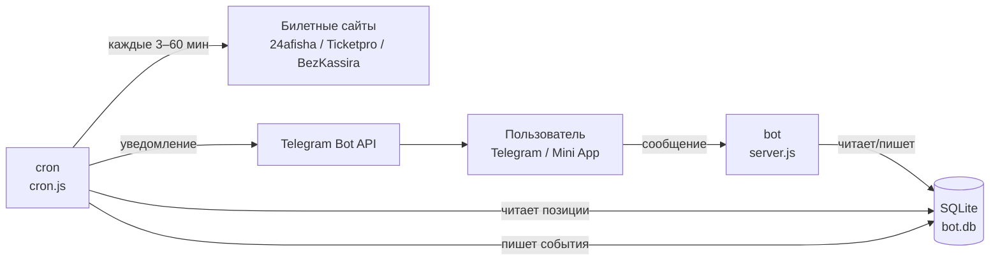

# Как работает бот

Коротко: бот держит в базе список твоих «позиций слежения», в фоне (отдельный
процесс `cron`) периодически ходит на билетные сайты, сравнивает их ответ с тем,
что лежит в базе, и присылает в Telegram уведомление, как только билеты
поступают в продажу.

---

## 1. Общая схема

Три контейнера (`docker-compose.yml`):

| Сервис | Файл | Что делает |
|---|---|---|
| `bot` | `server.js` | Принимает вебхук Telegram (`POST /webhook`), раздаёт меню/мини-приложение, применяет миграции БД при старте |
| `cron` | `cron.js` | Бесконечный цикл проверки билетов, уведомления, ежедневная сводка |
| `web` | Caddy | HTTPS + прокси на `bot` |

Оба процесса работают с одной SQLite-базой (volume `tickets-data`, `DB_PATH=/data/bot.db`).

---

## 2. Что такое «позиция слежения»

Пользователь добавляет позицию (`watch_items`), она бывает трёх типов:

| `kind` | Что отслеживается | Пример |
|---|---|---|
| `query` | ключевое слово / исполнитель | «Сплин», «РТБД» |
| `event` | конкретная страница события | `https://24afisha.by/ru/minsk/event/...` |
| `venue` | площадка целиком | Дворец спорта, кинотеатр «Мир» |

Плюс `city` — города:

- `'brest'` и т.п. — конкретный город;
- `'all'` — все города;
- `NULL` — город берётся из URL события.

Источники (`source`): `all` (все), `afisha`, `ticketpro`, `bezkassira`.

---

## 3. Цикл проверки (главное — как часто)

Цикл реализован в `runCheck()` (`lib/checker.js`), запускается из `cron.js`.

### Расписание

Интервалы **случайные** внутри диапазона — это защита от антибот-фильтров
билетных сайтов (ровный «такт» легко детектируется). Часы считаются по
Минску (`TZ=Europe/Minsk`):

| Время (Минск) | Интервал между циклами | Режим |
|---|---|---|
| 17:00–21:00 | **3–6 минут** | `peak` (вечерний пик) |
| 09:00–17:00 | **5–10 минут** | `day` |
| 21:00–09:00 | **30–60 минут** | `night` |

Первый цикл стартует сразу при запуске контейнера — ждать таймер не нужно.

> Это интервалы **запуска цикла**. Сколько конкретных событий проверяется
> внутри цикла — ограничено бюджетом запросов (см. п. 5) и «свежестью» данных
> (см. п. 4).

### Минимальный интервал между циклами

Независимо от таймера есть защита от двойного запуска: цикл не начнётся, если
с прошлого прошло меньше `CHECK_INTERVAL_MIN = 3`
(`lib/config.js`). Это страхует ручной `GET /check` поверх таймера.

Принудительно (игнорируя guard) — `CHECK_FORCE=1`.

### Что происходит за цикл

1. Одноразовые/периодические починки данных (прошедшие события → не «в продаже»,
   нормализация городов и т.п.).
2. Читаются все активные позиции (`activeWatchItems()`).
3. Позиции **переупорядочиваются** — не по порядку добавления:
   - сначала те, что дольше всех не проверялись («долг»);
   - при равном долге — те, чьё событие **ближе к старту** (окно 14 дней, бонус до +10);
   - позиции, которым отказывали в бюджете, накапливают долг и в следующих циклах идут первыми.
4. Каждая позиция проверяется по указанному источнику.
5. Найденные события апсертятся в таблицу `events`, при появлении продажи
   отправляется уведомление (см. п. 6).
6. Итоги пишутся в `check_log` и в лог контейнера.

---

## 4. Как часто перечитывается **уже известное** событие

Бить по странице каждого известного события каждый цикл — дорого и подозрительно.
Поэтому для уже найденных событий действует индивидуальный интервал
(`recheckInterval()` / `needsRecheck()`), зависящий от того, насколько близко старт:

| До старта события | Переинтервал | Комментарий |
|---|---|---|
| ≤ 7 дней | **1 час** | «горячее»: билеты появляются и исчезают быстро |
| 8–14 дней | **3 часа** | обычный режим |
| > 14 дней | **24 часа** | далеко: продажи ещё не будет, экономим запросы |
| дата неизвестна | 3 часа (если в продаже) / 24 часа | данных мало |

Важно: событие, которое **уже в продаже**, тоже перечитывается — билеты могут
закончиться и вернуться (возвраты), событие могут перенести или отменить.

---

## 5. Бюджет запросов за цикл

Чтобы один цикл не растягивался до десятков минут и не выглядел как DDoS,
запросы к сайтам лимитированы (`lib/budget.js`, `lib/config.js`).

| Параметр | Значение | Смысл |
|---|---|---|
| `DETAIL_BUDGET` | **24** | сколько «детальных» запросов к сайтам можно сделать за цикл |
| `VENUE_BUDGET_RESERVE` | 1/3 бюджета (8) | резерв под обход площадок, найденных поиском |
| `DETAIL_BUDGET_MIN_PER_CHAT` | 1 | минимальная квота чата, остаток делится пропорционально числу позиций |
| `MAX_CITY_PROBES` | 10 | максимум проверок городов внутри одной позиции |
| `MAX_VENUE_RESULTS_PER_QUERY` | 3 | площадок из одного поиска за цикл |
| `MAX_VENUE_EVENTS` | 40 | событий площадки за один обход |
| `VENUE_CRAWL_BUDGET_MS` | 20 000 мс | общий таймаут обхода площадок на один запрос |
| `VENUE_QUERY_RECHECK_MS` | 3 часа | как часто повторно обходить ту же площадку по тому же запросу |
| `FETCH_TIMEOUT_MS` | 9 000 мс | таймаут одного HTTP-запроса |
| `SEARCH_CACHE_TTL_MS` | 5 минут | кэш результатов поиска (какие события существуют) |

Бюджет — это **потолок**, а не расход: в обычном цикле тратится только то, что
реально требует проверки. Позиция, которой не хватило бюджета, помечается как
отложенная и получает приоритет в следующем цикле.

---

## 6. Когда приходит уведомление

Уведомление отправляется, только если одновременно:

- у события `onSale = true` и статус не `cancelled`;
- для этого чата ещё **не было** уведомления по этому событию.

Дедупликация (`notificationKey()`): `normText(название)` + **день старта события**.
Поэтому:

- одно и то же событие с разных сайтов (Афиша/Ticketpro/BezKassira) → **одно**
  уведомление;
- события «на 12 октября» и «на 13 октября» → два разных уведомления;
- повторного спама по одному событию нет никогда.

Ограничение записи — `notifications(chat, dedupe_key)` уникально.

### Как выглядит

- Если есть постер — `sendPhoto` с подписью, иначе `sendMessage` (текстом,
  с запасной ссылкой).
- В подписи: название, дата, город, площадка, цена.
- Кнопки: «Купить билеты» (ссылка) и 🔕 отписка от позиции.
- Для событий Афиши ссылка подменяется на рабочую (bycard.by), если оригинальная
  страница падает с 500 (`afishaWorkingEventUrl()`).

---

## 7. Источники и как берётся наличие

| Источник | Поиск | Наличие билетов |
|---|---|---|
| **Афиша** (24afisha.by + bycard.by, общий бэкенд) | поиск по сайту | JSON-LD события + schedule API по городу; для кино — только schedule API |
| **Ticketpro.by** | поиск + категории площадок | детальная страница события |
| **BezKassira.by** | поиск + события организатора | детальная страница события |

Особенности Афиши:

- события кэшируются **по городу**: `uid = '<slug>@<city>'`, одно и то же
  событие в Минске и Бресте — две разные записи (разное наличие);
- площадки — отдельный публичный API и отдельный список киносеансов;
- прошлые события принудительно снимаются с «в продаже» (`isSaleOpen` у
  источника бывает вечно `true`).

---

## 8. Взаимодействие с пользователем

### Команды

| Команда | Что делает |
|---|---|
| `/start` | приветствие + главное меню (в т.ч. диплинк `/start unsub_<id>` для отписки) |
| `/list` | список позиций: 🔕 отписаться, название → страница события/площадки |
| `/help` | справка + режим «написать разработчику» |
| `/stats` | отчёт по циклам (только владельцу, `STATS_CHAT_ID`) |

### Произвольный текст

Любое сообщение не-команда бот трактует как кандидат в ключевое слово и
предлагает добавить его в отслеживание (кнопки «Добавить» / «Найти в мини-приложении»).

### Мини-приложение

`miniapp/` (GitHub Pages) — живой поиск событий и площадок, выбор города,
управление списком. Данные передаются в бота через `web_app_data`,
обработчик — `lib/webapp.js`. Список городов события в мини-приложении
подтягивается с сервера: `GET /api/event-cities?url=…`.

---

## 9. Ежедневная сводка

Отдельный таймер в `cron.js`: **каждый день в 09:00 по Минску** владельцу
(`STATS_CHAT_ID`) уходит отчёт по `check_log` за сутки:

- сколько циклов, средняя и максимальная длительность;
- сколько уведомлений отправлено;
- утилизация бюджетов (`DETAIL_BUDGET`, обход площадок) и проценты;
- сколько позиций отложено/пропущено и почему;
- кэш поиска: попадания/промахи.

Детальность логов цикла задаётся `CHECK_LOG_LEVEL`: `summary` (одна строка на
цикл), `items` (+ строка на позицию), `debug` (+ причина каждого пропуска).

---

## 10. Хранение данных

| Таблица | Что лежит |
|---|---|
| `users` | чаты, которые писали боту |
| `watch_items` | позиции слежения (тип, источник, запрос, город, `active`, долг) |
| `events` | найденные события: `source` + `uid`, название, дата, цена, `onSale`, `lastCheckedAt` |
| `notifications` | отправленные уведомления: `chat_id` + `dedupe_key` (защита от дублей) |
| `check_log` | статистика каждого цикла |
| `meta` | служебные значения (`lastCheckAt`, сдвиг обхода, флаги одноразовых починок) |

Внешних ключей нет — целостность (например, «позиция принадлежит этому чату»)
проверяется в коде.

---

## 11. Типичный путь «от добавления до уведомления»

1. Пользователь пишет «Сплин» → бот предлагает добавить → создаётся
   `watch_items(kind='query', query='Сплин')`.
2. Через ≤ 10 минут (днём) `cron` подходит к этой позиции и ищет «Сплин»
   в источниках. Результаты поиска кэшируются на 5 минут.
3. Найденное событие пишется в `events` с `onSale=false` (если продажи нет).
4. Дальше оно перечитывается по правилам п. 4: ≤ 7 дней до старта — раз в час,
   8–14 дней — раз в 3 часа, дальше — раз в сутки.
5. Как только источник отдаёт `onSale=true`, а уведомления по этому событию
   ещё не было → уходит карточка с постером, ценой и кнопкой «Купить билеты».
6. Повторно по этому событию бот не напишет.

---

## Связанные документы

- `README.md` — описание для пользователя.
- `docs/SERVER_GUIDE.md` — сервер, логи, БД, рецепты.
- `docs/DEPLOY_DROPLET.md` — деплой на Droplet.
- `AGENTS.md` — правила разработки в проекте.
